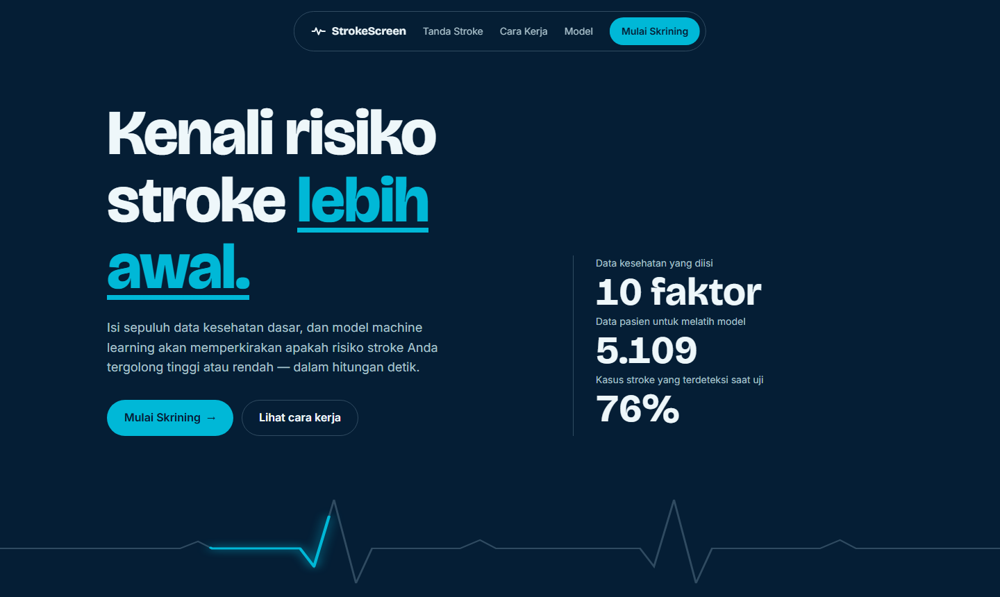
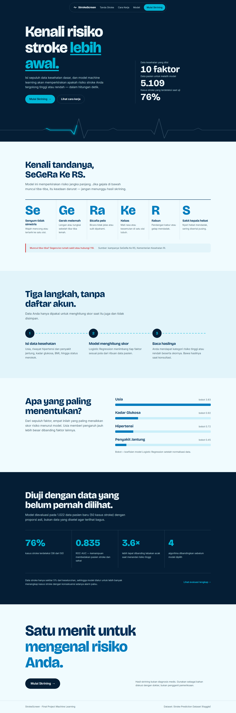
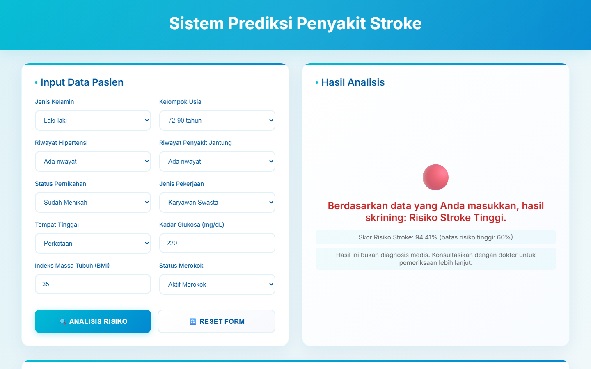
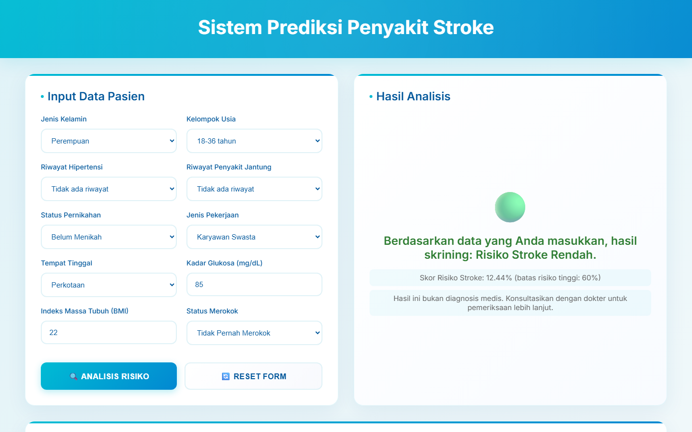
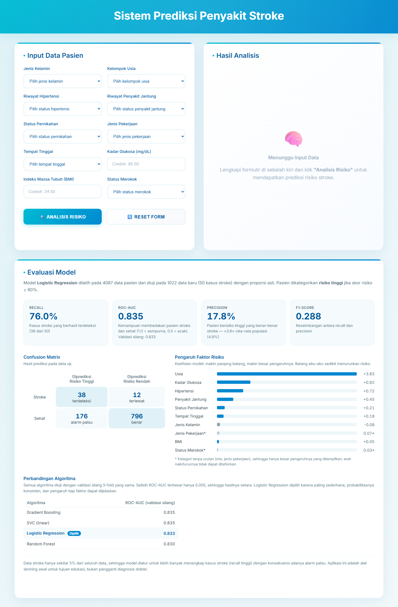

# Website Prediksi Risiko Stroke Berbasis Machine Learning

Aplikasi web untuk skrining awal risiko stroke berdasarkan 10 faktor kesehatan dasar. Pengguna mengisi formulir, lalu model **Logistic Regression** menghitung skor risiko dan mengategorikannya sebagai **Risiko Stroke Tinggi** atau **Risiko Stroke Rendah**.

> ⚠️ Proyek akademik (Final Project Machine Learning). Hasil prediksi bukan diagnosis medis.



## Fitur

- Halaman beranda: tanda-tanda stroke (SeGeRa Ke RS), cara kerja, faktor risiko utama, dan kinerja model
- Formulir 10 faktor risiko dengan validasi rentang nilai
- Hasil skrining dengan kode warna (🔴 risiko tinggi / 🟢 risiko rendah)
- Skor risiko dalam persen beserta batas risiko tinggi (60%)
- Isian formulir tetap tersimpan setelah prediksi untuk membandingkan skenario
- Bagian **Evaluasi Model**: recall, ROC-AUC, precision, F1-score, confusion matrix, dan pengaruh tiap faktor risiko — dibaca otomatis dari hasil `train_model.py`

## Dataset

[Stroke Prediction Dataset](https://www.kaggle.com/datasets/fedesoriano/stroke-prediction-dataset) — 5.110 data pasien, hanya **4,9% kasus stroke** (sangat tidak seimbang).

| Fitur | Keterangan |
|---|---|
| `gender` | Jenis kelamin |
| `age` | Usia, dikelompokkan: 0-18, 18-36, 36-54, 54-72, 72-90 |
| `hypertension`, `heart_disease` | Riwayat hipertensi / penyakit jantung (0/1) |
| `ever_married`, `work_type`, `Residence_type` | Status menikah, jenis pekerjaan, tempat tinggal |
| `avg_glucose_level`, `bmi` | Rata-rata kadar glukosa, indeks massa tubuh |
| `smoking_status` | Status merokok |

## Metode

1. **Pra-pemrosesan** — BMI kosong diisi median dan dibatasi 10.3–43, usia dikelompokkan, fitur kategorikal di-encode dengan `LabelEncoder` per kolom.
2. **Split data** — 80% latih / 20% uji secara *stratified*. Data uji dibiarkan dengan proporsi asli agar evaluasi realistis.
3. **Normalisasi** — `MinMaxScaler` di-fit hanya pada data latih.
4. **Penanganan data tidak seimbang** — `class_weight='balanced'`, tanpa menduplikasi data sehingga tidak terjadi kebocoran data (*data leakage*).
5. **Pemilihan model** — 5-fold stratified cross-validation (metrik ROC-AUC) untuk membandingkan model dan memilih hyperparameter.
6. **Threshold** — skor ≥ 0,6 dikategorikan risiko tinggi, sebagai titik tengah antara recall dan precision.

### Perbandingan Model (data uji, threshold 0,5)

| Model | Recall | Precision | F1 | ROC-AUC |
|---|---|---|---|---|
| **Logistic Regression** ✅ | 0.80 | 0.13 | 0.22 | 0.835 |
| SVC (linear) | 0.82 | 0.13 | 0.22 | 0.837 |
| Random Forest | 0.78 | 0.17 | 0.27 | 0.841 |
| Decision Tree | 0.74 | 0.11 | 0.20 | 0.773 |
| K-Nearest Neighbors | 0.48 | 0.10 | 0.17 | 0.676 |

Logistic Regression dipilih karena performanya setara dengan model terbaik, probabilitasnya konsisten dengan prediksi, dan koefisiennya dapat dijelaskan.

### Hasil Model Akhir (threshold 0,6)

| Recall | Precision | F1 | ROC-AUC |
|---|---|---|---|
| **0.76** | 0.18 | 0.29 | **0.835** |

Model mendeteksi 38 dari 50 kasus stroke pada data uji. Precision rendah merupakan konsekuensi data yang sangat tidak seimbang: dari setiap ~5 orang yang ditandai berisiko tinggi, 1 benar-benar mengalami stroke — tetap sekitar 3,6× lebih tinggi dari rata-rata populasi. Untuk alat skrining, melewatkan kasus stroke lebih berbahaya daripada alarm palsu.

**Faktor paling berpengaruh** (koefisien model): usia, kadar glukosa, hipertensi, dan penyakit jantung.

## Tech Stack

- **Machine Learning:** Python, scikit-learn, pandas, NumPy
- **Backend:** Flask
- **Frontend:** HTML, CSS, Jinja2

## Struktur Proyek

```
Stroke-Prediction/
├── app.py                  # Aplikasi web Flask
├── train_model.py          # Script pelatihan model
├── requirements.txt
├── data/
│   └── dataset-stroke.csv
├── models/                 # Hasil train_model.py
│   ├── best_model.pkl
│   ├── fitted_label_encoders.pkl
│   ├── fitted_min_max_scaler.pkl
│   └── model_metrics.json  # Metrik evaluasi untuk website
├── notebooks/
│   └── ClassificationModel.ipynb   # Eksplorasi awal (EDA)
├── docs/screenshots/       # Tangkapan layar aplikasi
└── templates/
    ├── landing.html        # Halaman beranda (/)
    └── index.html          # Formulir skrining & evaluasi model (/prediksi)
```

## Menjalankan Aplikasi

```bash
pip install -r requirements.txt
python app.py
```

Buka http://127.0.0.1:5000 (beranda) atau langsung ke http://127.0.0.1:5000/prediksi (formulir skrining).

## Melatih Ulang Model

```bash
python train_model.py
```

Script menampilkan metrik evaluasi dan menyimpan model, encoder, scaler, serta `model_metrics.json` ke folder `models/`. Restart `app.py` agar website memakai model dan metrik terbaru.

## Tampilan Aplikasi

**Beranda**



**Hasil Skrining — Risiko Tinggi**



**Hasil Skrining — Risiko Rendah**



**Halaman Skrining dengan Evaluasi Model**


